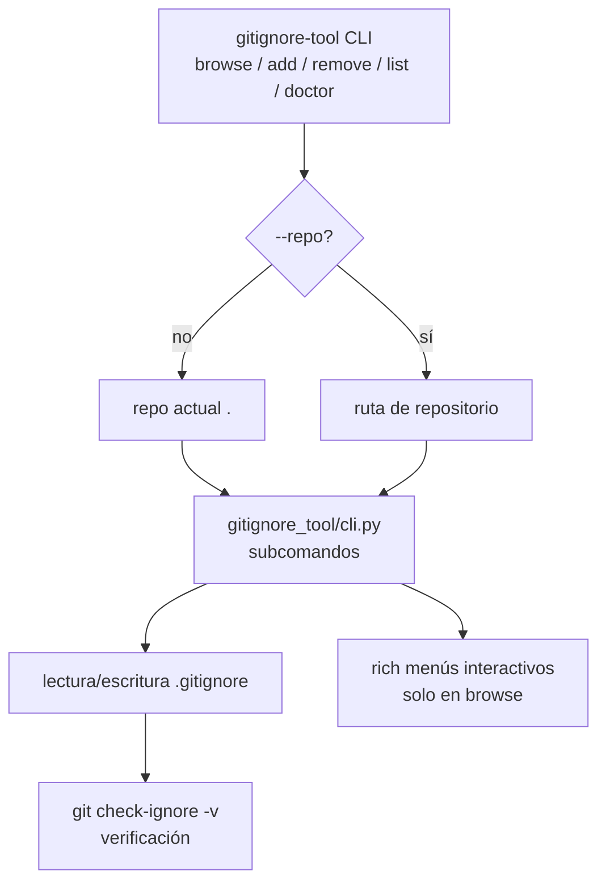

# autoignore

CLI instalable (`gitignore-tool`) para crear, modificar y auditar archivos `.gitignore` desde la terminal: navegación interactiva, alta/borrado de patrones, listado y verificación con `git check-ignore`.

[](LICENSE)
[](https://python.org)
[](https://github.com/drbash/autoignore/actions)

## Contenido

- [Características](#características)
- [Arquitectura](#arquitectura)
- [Stack](#stack)
- [Estructura del repositorio](#estructura-del-repositorio)
- [Instalación](#instalación)
- [Uso](#uso)
- [Tests / CI](#tests--ci)
- [Roadmap](#roadmap)
- [Licencia](#licencia)

## Características

- Navegación interactiva por archivos y directorios (`browse`).
- Alta de patrones en `.gitignore` (`add`).
- Remoción de patrones exactos (`remove`).
- Listado del contenido actual de `.gitignore` (`list`).
- Verificación con `git check-ignore` (`doctor`, integrada también con `--verify` en `add`).
- Modo no interactivo para scripting.

## Arquitectura



## Stack

| Componente | Tecnología |
|---|---|
| Lenguaje | Python 3.10+ |
| CLI | `argparse` (stdlib) |
| Interacción | `rich` para menús interactivos |
| Testing | pytest |
| Lint | Ruff |

## Estructura del repositorio

```
autoignore/
├── src/
│   └── gitignore_tool/
│       ├── __init__.py
│       └── cli.py              # CLI principal
├── scripts/
│   ├── install_local.sh        # pip install -e .
│   ├── demo_run.sh             # Script de demo
│   └── demo_interactive.sh     # Demo del modo interactivo
├── tests/
│   └── test_smoke.py
├── .env.example
├── pyproject.toml
├── .github/workflows/ci.yml
└── LICENSE
```

## Instalación

Requisitos: Linux recomendado, Python 3.10+ y Git en PATH.

```bash
git clone https://github.com/drbash/autoignore.git
cd autoignore
python3 -m pip install -e .
```

## Uso

```bash
# Navegación interactiva
gitignore-tool browse --repo ./un/repo

# Agregar una ruta directamente
gitignore-tool add .env --repo ./un/repo
gitignore-tool add logs/ --repo ./un/repo --verify

# Listar reglas actuales
gitignore-tool list --repo ./un/repo

# Eliminar una regla exacta
gitignore-tool remove logs/ --repo ./un/repo

# Verificar una ruta con Git
gitignore-tool doctor logs/app.log --repo ./un/repo
```

Nota: si un archivo ya estaba trackeado por Git, agregarlo a `.gitignore` no basta; hay que sacarlo del índice con `git rm --cached ruta/al/archivo`.

## Tests / CI

```bash
pip install pytest
pytest tests/ -v
```

CI: GitHub Actions (`.github/workflows/ci.yml`) ejecuta Ruff y pytest en cada push/PR.

## Roadmap

- [x] Navegación interactiva + comandos directos
- [x] Verificación con `git check-ignore`
- [ ] Plantillas por lenguaje/stack (Python, Node, etc.)
- [ ] Soporte para `.gitignore` global
- [ ] Autocompletado en shell
- [ ] Generación de `.gitignore` desde cero con wizard

## Licencia

MIT — ver [LICENSE](LICENSE).